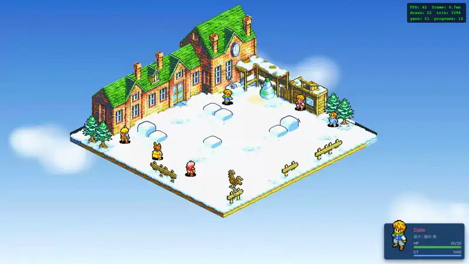

# FFTA snowball fight demo

The opening snowball fight of Final Fantasy Tactics Advance, rebuilt as a freely rotating 3D board in the browser with Three.js.

**Play:** [ffta.cheerchen.me](https://ffta.cheerchen.me)



The original 2.5D art only draws the side facing the default camera. How the hidden walls and roofs were filled in is written up in [From Isometric to 3D](https://cheerchen.me/en/posts/ffta-isometric-to-3d-the-far-side-of-the-moon/) ([中文](https://cheerchen.me/posts/ffta-isometric-to-3d-the-far-side-of-the-moon/)).

## Controls

| Input | Action |
|---|---|
| <kbd>Q</kbd> / <kbd>E</kbd> | Rotate the camera between the four directions |
| Click a unit | View its status |
| Click a blue tile | Move |
| Click an enemy | Attack (melee or snowball) |
| <kbd>B</kbd> | Toggle the school texture / white model |

The interface follows the browser language: English, Simplified Chinese, Traditional Chinese, or Japanese.

## Run locally

No build step. Serve the repository root with any static server, for example:

```sh
python3 -m http.server
```

Then open <http://localhost:8000>.

## Disclaimer

Fan-made, not affiliated with Square Enix. Final Fantasy Tactics Advance and its characters and artwork belong to Square Enix.
